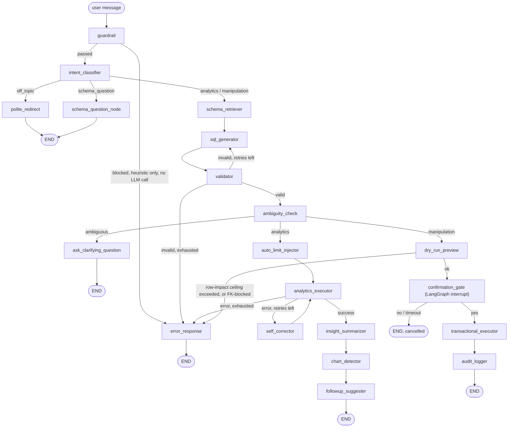

# QueryPilot

A conversational text-to-SQL agent — ask a database questions in plain
English, or ask it to change something, and watch the agent's own trace as
it validates, previews, and (only after you confirm) executes.

- **Analytics** — ask questions in plain English, get SQL + results + a
  streamed plain-language summary + a chart when the data supports one.
- **Manipulation** — ask for a change (`cancel order 42`, `mark invoice 88
  as paid`), get a preview of exactly which rows would change (including
  FK cascades), and nothing happens until you explicitly confirm.

Every generated SQL statement is deterministically validated (sqlglot AST
inspection, live schema checks, a row-impact ceiling) before it ever
touches the database. **Prompts are not the safety boundary —
`app/core/validator.py` is**, and nothing in later phases (caching,
observability, the LLM provider fallback chain) is allowed to weaken that.

The demo domain is a cold-drinks manufacturing & wholesale distribution
business across Ratnagiri district: products, retailers, orders,
order_items, payments, inventory — ~8,000 orders spanning 2024-2026 with a
real seasonal pattern (summer spike, monsoon dip).

## Live demo

| | |
|---|---|
| Frontend (Vercel) | https://query-pilot-nine.vercel.app/ |
| Backend (Render) | https://querypilot-backend-onts.onrender.com|
| Fallback UI | `<backend URL>/` — `frontend/index.html`, served directly by FastAPI, no build step |

The backend is a Render free-tier instance: it spins down after 15 minutes
idle and takes up to ~1 minute to wake back up on the next request. The
frontend's cold-start gate polls `/health` for up to 90s and shows elapsed
time instead of a broken-looking page — see [Cold starts](#cold-starts).

## Architecture



Every node emits a `node_state` SSE event
(`pending → running → succeeded | degraded | failed | not_reached | skipped_cached`),
so the frontend's center pane renders this exact graph live as a run
executes — including which retry loop fired, which node the validator
rejected SQL at, and which downstream nodes never ran because an earlier
one failed. See [Observability](#observability).

- **Guardrails are code, not prompts.** `app/core/validator.py` whitelists
  statement types, requires a `WHERE` on every write, checks every
  table/column against the *live* schema, and enforces a row-impact
  ceiling via an actual dry-run `COUNT(*)`. `app/core/dry_run.py` rewrites
  `DELETE`/`UPDATE` into `SELECT`s via AST manipulation (not string
  surgery), so the preview's `WHERE` is guaranteed identical to what would
  execute. A heuristic `guardrail` node runs first and catches
  prompt-injection/PII/gibberish patterns with zero LLM cost — but it
  deliberately never pattern-matches SQL keywords, so a message like
  `DROP TABLE orders` sails through it and reaches the validator, which is
  what actually blocks it. This split is intentional: the "Try to break
  it" row in the demo UI shows exactly which layer catches each attack.
- **Schema retrieval is embedding-based**, not a full-schema dump per
  prompt: table descriptions are embedded with Gemini's
  `gemini-embedding-001` and cached to a JSON file keyed by content hash —
  no vector database — and the top-k relevant tables are retrieved per
  request, including live sample rows and explicit enum-value lists for
  low-cardinality columns. If embedding fails for any reason (quota,
  network), it falls back to injecting the full schema (small enough at 6
  tables to be nearly free) and emits a `degraded` node state instead of
  failing the request.
- **The LLM gateway is provider-agnostic and self-healing.** Every node
  asks for an alias (`sql_gen` or `chat`), never a literal model — the
  ordered fallback chain lives in `config/model_groups.yaml`. See
  [Provider fallback](#provider-fallback).
- **Confirmation is a real LangGraph interrupt**, not a fake two-step flow:
  the graph pauses via `interrupt()`, state is checkpointed to SQLite
  (`langgraph-checkpoint-sqlite`), and the API's `/confirm` endpoint
  resumes it with `Command(resume=...)`. A confirmation is scoped to one
  browser session's own sandbox database, never the shared template.

## Provider fallback

Every alias (`sql_gen`, `chat`) has its own ordered chain in
`config/model_groups.yaml`, live-verified against the real provider APIs
(see `docs/phases/01-llm-gateway.md` for the full verification log,
including models that were tried and rejected):

| Order | Provider | `sql_gen` model | `chat` model |
|---|---|---|---|
| 1 | Ollama Cloud | `gpt-oss:120b` | `gpt-oss:20b` |
| 2 | OpenRouter | `cohere/north-mini-code:free` | `nvidia/nemotron-3-super-120b-a12b:free` |
| 3 | Gemini | `gemini-3.6-flash` | `gemini-3.6-flash` |
| 4 | Groq | `openai/gpt-oss-120b` | `openai/gpt-oss-20b` |

On a timeout, connection error, 5xx, 429, or 401/403/404, the gateway
advances to the next deployment (retrying transient errors once first) and
puts the failing deployment on a 10-minute cooldown. It does **not**
advance on 400/422 (a malformed request fails identically everywhere) or
on a refusal. A deployment-specific bad response — observed live and
documented in `docs/phases/05-evals-ci.md`, where a free-tier OpenRouter
model occasionally returns a response with no `choices` — is classified
and advanced past rather than aborting the whole chain. If every
deployment in a chain fails, the client sees a single honest
`ALL_PROVIDERS_FAILED` error, never a raw exception. `GET
/health/providers` pings every configured deployment live (a real,
billable call — the frontend polls it only on demand, never on a timer).

`QP_LLM_PROFILE=local` forces every alias onto a single local Ollama
deployment instead, for offline development — see [Local
development](#local-development).

**Bring your own key.** `byok_provider` + `byok_api_key` on a `/chat`
request routes that one request through the caller's own key, bypassing
both the shared fallback chain and the daily budget cap. The key is never
logged or persisted, and is redacted from any error text that might echo
it back.

## Observability

Every graph run streams a rich SSE event vocabulary, all consumed live by
the frontend's center (trace) and right (results) panes:

- `node_state` — `pending → running → succeeded | degraded | failed | not_reached | skipped_cached`, one per node, computed straight from LangGraph's own task-start/task-end stream (not inferred).
- `guardrail`, `validator_verdict` — the heuristic guardrail's verdict, and a structured list of which validator checks ran and passed (statement type, tables/columns exist, WHERE-clause required, auto-LIMIT injected, row-impact within ceiling).
- `llm_attempt`, `cache_hit` — provider, model, latency, tokens, cost per attempt; forwarded live from the same events `app/core/budget.py` uses to track spend.
- `sql_generated`, `preview`, `awaiting_confirmation`, `result`, `chart`, `followups`, `token` (streamed insight text) — the existing per-node semantic payloads.
- `error` — `{code, message, node}` from the taxonomy below, never a raw exception.
- `heartbeat` — every 15 seconds, so a slow multi-provider fallback chain (observed live at 30-250+ seconds in a worst case) never looks like a dead connection.
- `done` — a per-run summary: total latency, per-node latency, LLM attempts by provider, tokens, cost, cache savings, and (if Langfuse is configured) a trace URL.

**Error taxonomy** (`app/core/errors.py`): every error crossing the API
boundary is `{code, message, node}` — `PROVIDER_TIMEOUT`,
`PROVIDER_RATE_LIMIT`, `PROVIDER_AUTH_FAILED`, `PROVIDER_UNAVAILABLE`,
`ALL_PROVIDERS_FAILED`, `GUARDRAIL_BLOCKED`, `VALIDATION_BLOCKED`,
`ROW_CEILING_EXCEEDED`, `FK_BLOCKED`, `SCHEMA_VALIDATION_FAILED`,
`SESSION_EXPIRED`, `SESSION_INVALID`, `RATE_LIMITED`, `BUDGET_EXCEEDED`,
`INTERNAL`. Every one of these has a designed UI state in the frontend
(a message plus a next action — retry, reset sandbox, add your own key,
wait for the rate limit) — never a blank screen or raw exception text.

**Optional Langfuse tracing** activates automatically when
`LANGFUSE_PUBLIC_KEY`/`LANGFUSE_SECRET_KEY` are set: one trace per `/chat`
or `/confirm` call, one span per node, one generation per LLM attempt. A
Langfuse outage or missing keys never breaks a request either way.

## Frontend

`web/` is a Next.js 16 (App Router, TypeScript, Tailwind 4) app, deployed
to Vercel with `web/` as the project root. It talks to the backend
**directly** — `NEXT_PUBLIC_API_BASE_URL`, no Next.js API routes, no
proxying of the SSE stream through a serverless function. `frontend/
index.html` is kept as a lightweight, build-step-free fallback UI served
directly by FastAPI.

Three panes:

- **Sandbox & context** (left) — a session card (your own isolated
  sandbox database, with a reset button), a table browser with a
  paginated preview modal, example prompts split into analytics/
  manipulation, a **"Try to break it"** row of preset attacks (`DROP TABLE
  orders`, "delete all orders", a prompt-injection attempt, "update every
  retailer's credit limit to 0") that each show live which layer blocks
  them, provider status dots, a budget meter, and a bring-your-own-key
  form (shown automatically once the budget is exceeded).
- **Live agent trace** (center) — the graph above, rendered as a vertical
  pipeline with live `node_state` styling; retries, self-correction loops,
  and validator rejections are all visible as they happen, each node
  showing its latency and which provider answered.
- **Results** (right) — syntax-highlighted generated SQL with validator-
  check badges, a results table, a chart, the streamed insight, clickable
  follow-up suggestions, a preview card for writes (exact rows, FK
  cascade preview, confirm/cancel with a live countdown matching
  `QP_CONFIRMATION_TIMEOUT_SECONDS`), an audit tab, and a run summary.

Design tokens (the dark, restrained teal/amber/coral "control-room
telemetry" palette, and the `NodeState` styling) are shared with the
sibling `Crewai-Research-pipeline` project's dashboard.

## Guardrails (all code, not prompts)

1. Statement whitelist: only `SELECT`/`INSERT`/`UPDATE`/`DELETE`; everything
   else (`DROP`, `TRUNCATE`, `ALTER`, `CREATE`, `GRANT`, `PRAGMA`,
   `ATTACH`, `VACUUM`, ...) is rejected by AST node type, not keyword
   matching.
2. Single statement only — multi-statement input (`;`-separated, including
   classic injection payloads) is rejected.
3. `WHERE` required on every `DELETE`/`UPDATE`.
4. Every referenced table/column is checked against the *live* schema
   (`PRAGMA table_info`), catching hallucinated references.
5. Row-impact ceiling (default 50): a real dry-run `COUNT(*)` against the
   write's actual `WHERE` clause; anything over the limit is blocked
   before the user ever sees a confirmation prompt. For `DELETE`, this
   walks the live foreign-key graph too — cascade-deleted rows in other
   tables count toward the ceiling, not just the target table.
6. Auto-`LIMIT` on analytics `SELECT`s that lack one.
7. Read-only enforcement at the SQLite driver level (`mode=ro` URI) — a
   validator bug cannot result in a write on the analytics path, because
   the connection itself is incapable of writing.
8. `EXPLAIN` pre-flight before every real execution.
9. Transactions: `BEGIN` → execute → `COMMIT`, `ROLLBACK` on any error.
10. Every manipulation request logged to the operational database
    (Neon Postgres in production, a local SQLite file otherwise) via
    `app/core/audit.py`: timestamp, input, SQL, validation outcome,
    preview, confirmed/cancelled, rows affected, latency, retry count.
11. `QP_READ_ONLY_MODE=true` disables the manipulation path entirely.
12. **Foreign-key-aware deletes.** `orders → order_items` and
    `orders → payments` are `ON DELETE CASCADE`, so
    `validator.check_row_impact` walks `PRAGMA foreign_key_list` on every
    table: rows in `ON DELETE CASCADE` children are *shown in the preview*
    and counted toward the row-impact ceiling; rows in children *without*
    a cascade path (e.g. `order_items.product_id`, `orders.retailer_id` —
    deliberately not cascaded, so deleting a product or retailer never
    silently wipes historical order data) **block the delete outright**
    with a clear reason, before the user ever sees a confirmation prompt.
13. **A heuristic input guardrail** runs before any LLM call: message
    length, a gibberish-symbol-ratio check, prompt-injection/role-override
    phrase patterns, and PII patterns (email, SSN-shaped, credit-card-
    shaped digit runs). Zero LLM cost on a block. Deliberately does *not*
    pattern-match SQL keywords — see [Architecture](#architecture) above.
14. **Per-session sandboxing.** Every visitor gets their own SQLite copy
    of the seeded template database; the analytics/manipulation guardrails
    above all introspect that session's own live schema, never a shared
    one two visitors could race on.
15. **A per-IP rate limit** (`QP_RATE_LIMIT_PER_MINUTE`, default 10) and a
    **daily USD budget cap** (`QP_DAILY_BUDGET_USD`) on top of everything
    above — both bypassable per-request only via BYOK.

`tests/test_guardrails.py` (40 tests) and `tests/test_guardrail_input.py`
cover the adversarial set: `DROP TABLE`, `'; DROP TABLE products; --`,
DELETE/UPDATE without `WHERE`, queries against nonexistent tables/columns,
>50-row writes, the cascade/foreign-key cases above, and the heuristic
guardrail's own block/pass cases. All 279 backend tests pass (excluding 3
tests in `test_schema_embeddings.py` that make real, occasionally
quota-limited Gemini API calls — documented in-file as expected).

## Evals

`python -m evals.run_evals` runs 68 hand-written cases (10 simple selects,
10 joins, 10 aggregations, 10 time/seasonal, 5 follow-up/context, 10
manipulation commands, 8 guardrail cases, 5 deliberately ambiguous
requests) through the real agent graph — same code path as production —
using the Phase 1 cloud gateway and a fresh per-session sandbox database
per case, so a manipulation case's real commit can never contaminate
another case or the shared template. It measures **execution accuracy**
(does the agent's SQL return the same data as a hand-written reference
query, tolerating extra helpful columns, not string-matching SQL text)
and **guardrail correctness** (does the heuristic block what it should and
let through what it shouldn't) separately, each with a 95% bootstrap
confidence interval, plus p50/p95 latency.

### Latest scorecard (2026-09-21, live cloud run)

| Category | Passed | Accuracy | 95% CI |
| --- | --- | --- | --- |
| aggregation | 10/10 | 100.0% | [100.0%, 100.0%] |
| ambiguous | 5/5 | 100.0% | [100.0%, 100.0%] |
| followup | 4/5 | 80.0% | [40.0%, 100.0%] |
| guardrail | 8/8 | 100.0% | [100.0%, 100.0%] |
| join | 10/10 | 100.0% | [100.0%, 100.0%] |
| manipulation | 8/10 | 80.0% | [50.0%, 100.0%] |
| simple_select | 10/10 | 100.0% | [100.0%, 100.0%] |
| time_based | 9/10 | 90.0% | [70.0%, 100.0%] |
| **Execution accuracy** (all non-guardrail categories) | | **93.3%** | |
| **Guardrail correctness** | | **100.0%** | |

Latency: mean 35.9s, p50 20.6s, p95 131.1s per case — this run happened
while the Gemini free-tier embedding quota was fully exhausted for the
day, so every case paid a real retry-then-fallback penalty on `
schema_retriever` before degrading gracefully to the full schema; not a
clean steady-state number (documented in `docs/phases/05-evals-ci.md`).
The old **local-Ollama baseline** (60 cases, pre-cloud-gateway,
`evals/eval_results.local_ollama_baseline.json`) scored 100% with a mean
latency of 49.4s/case (max 835.9s) — the two aren't directly comparable
(different case sets, different infra), but p50 latency on the cloud
stack is faster despite everything above.

Every one of the 4 individual case failures in the latest run was traced
to a specific, understood cause, not left as an unexplained number — see
`docs/phases/05-evals-ci.md` for the full breakdown: one real
infrastructure rate-limit exhaustion (all 4 providers failed on one
call), one genuine multi-turn context miss by the model (a follow-up lost
the prior turn's "top 3 by revenue" ranking), and two cases of
`ambiguity_check` non-deterministically — and arguably reasonably —
asking about cascade-delete behavior before a destructive `DELETE`.

**`.github/workflows/eval.yml`** runs this suite on every push to `main`,
committing `evals/eval_results.json`/`evals/SUMMARY.md` back to the repo
and failing the job if guardrail correctness drops below 100% or
execution accuracy drops more than 5 points below the last committed run.

## Memory and latency

Measured on a fresh `docker build` of the exact image Render deploys
(`python:3.11-slim` base, no unusual dependencies), on 2026-09-21:

- **Image size**: 607MB (up from 581MB in Phase 2d — Phase 4's Langfuse +
  OpenTelemetry dependencies).
- **Idle RSS** (container up, before any request): ~133MiB.
- **Peak RSS under a real manipulation flow** (`docker run` the built
  image, real cloud providers end to end: guardrail → ... → confirmation
  → commit → audit): **152.6MiB**, about 30% of Render free tier's 512MB
  limit — see `docs/phases/07-docs-and-deployment.md` for the full sample
  sequence. Headroom for concurrent sessions is ample (each session's
  sandbox is a small SQLite file copy; the bulk of resident memory is the
  shared Python process, FastAPI/Uvicorn, and the loaded LLM/embedding/
  tracing client libraries).

## Deployment

Three free-tier services: **Render** (backend), **Vercel** (frontend),
**Neon** (Postgres — audit events and budget entries only; LangGraph
checkpoints and per-session sandboxes stay in ephemeral local SQLite,
which is fine to lose on a spin-down).

### 1. Neon (Postgres)

1. Create a free project at [neon.tech](https://neon.tech).
2. Copy the connection string from the dashboard (the bare
   `postgresql://...` string — QueryPilot normalizes it to the psycopg3
   dialect automatically). Keep it for step 2's `QP_DATABASE_URL`.
3. Nothing else to do here — `alembic upgrade head` (run automatically by
   the Docker image's `CMD`) creates `audit_events` and `budget_entries`
   on first deploy.

### 2. Render (backend)

1. Push this repo to GitHub (or your own fork).
2. In the Render dashboard: **New → Blueprint**, point it at the repo.
   Render reads `render.yaml` and creates a free-tier Docker web service
   (`querypilot-backend`) with every env var already declared — the ones
   marked `sync: false` need their values filled in:
   - `QP_DATABASE_URL` — the Neon connection string from step 1.
   - `QP_ADMIN_TOKEN` — any random string, for the `/audit` full-log admin
     view (optional; leave blank to disable it).
   - `QP_CORS_ALLOWED_ORIGINS` — leave blank for now, come back after step
     3 gives you the Vercel URL.
   - `OLLAMA_API_KEY`, `OPENROUTER_API_KEY`, `GEMINI_API_KEY`,
     `GROQ_API_KEY` — see [Local development](#local-development) for
     where to get each one. At minimum, one working provider per alias is
     enough for the fallback chain to function.
   - Optional: `LANGFUSE_PUBLIC_KEY`/`LANGFUSE_SECRET_KEY` (tracing).
3. Deploy. Render builds the Docker image (`Dockerfile`), which seeds
   `data/template.db` at build time, then the container's `CMD` runs
   `alembic upgrade head` before starting `uvicorn`. Health check path is
   `/health`.
4. Note the deployed URL (`https://<service>.onrender.com`) — this is
   `NEXT_PUBLIC_API_BASE_URL` for step 3.

### 3. Vercel (frontend)

1. In the Vercel dashboard: **New Project**, import the same repo, and
   set **Root Directory** to `web/`.
2. Add one environment variable: `NEXT_PUBLIC_API_BASE_URL` = the Render
   URL from step 2 (no trailing slash).
3. Deploy (Vercel auto-detects Next.js — no build config needed).
4. Go back to Render and set `QP_CORS_ALLOWED_ORIGINS` to the deployed
   Vercel URL (comma-separated if you also want to allow a preview
   domain), then redeploy the backend so the new CORS origin takes
   effect.
5. Open the Vercel URL. The cold-start gate will show "Waking up the
   backend…" for up to a minute if Render's instance was idle — see
   [Cold starts](#cold-starts).

### Cold starts

Render's free tier spins down a web service after **15 minutes** of no
inbound traffic and takes **up to ~1 minute** to cold-start the next
request. The frontend's `Dashboard` component polls `GET /health` (with a
90-second timeout) before rendering the three-pane app, showing an
explicit "Waking up the backend…" message with elapsed time instead of a
blank or broken-looking page. If the backend is already warm, this gate
is invisible (one fast `/health` call, then straight to the app).

## Local development

### Cloud providers (matches production)

```bash
python -m venv .venv
.venv/Scripts/activate        # or source .venv/bin/activate on macOS/Linux
pip install -r requirements-dev.txt

cp .env.example .env
# fill in at least one provider key per alias -- see config/model_groups.yaml
# for the fallback order, and the links in .env.example for where to get each key

python -m scripts.seed_db
alembic upgrade head           # local SQLite fallback if QP_DATABASE_URL is unset
uvicorn app.main:app --reload
```

Backend on `http://localhost:8000` (serves `frontend/index.html` as a
fallback UI at `/`). For the Next.js frontend:

```bash
cd web
cp .env.local.example .env.local   # NEXT_PUBLIC_API_BASE_URL=http://localhost:8000
npm install
npm run dev
```

Frontend on `http://localhost:3000`. Set `QP_CORS_ALLOWED_ORIGINS=http://localhost:3000`
in the backend's `.env` so the browser can call it.

### Offline, `local` Ollama profile

No cloud provider keys needed — `QP_LLM_PROFILE=local` forces every alias
onto a single local Ollama deployment (`config/model_groups.yaml`'s
`local:` section):

```bash
ollama pull qwen2.5-coder:14b
ollama pull qwen3:14b

# in .env:
QP_LLM_PROFILE=local
QP_OLLAMA_HOST=http://localhost:11434
```

Note: schema retrieval still calls Gemini's embedding API regardless of
`QP_LLM_PROFILE` (it's a separate concern from chat/SQL generation) — set
`GEMINI_API_KEY` even in local mode, or accept the automatic full-schema
fallback if you'd rather stay fully offline.

### Docker Compose

```bash
docker compose up
```

The `ollama` service (for the `local` profile) is an **opt-in profile**,
not started by default:

```bash
docker compose --profile local-llm up
```

### Backend tests

```bash
pytest -q
```

### Eval harness

```bash
python -m evals.run_evals                 # full 68-case suite
python -m evals.run_evals --filter guardrail   # one category, no LLM calls needed
```

### Frontend smoke tests

```bash
cd web
npx playwright install --with-deps chromium   # first time only
npm run test:e2e
```

Runs against a real locally-started backend for every fast/no-LLM
endpoint, with `/chat`/`/confirm`'s SSE streams intercepted by canned,
deterministic fixtures (`web/tests/fixtures/sse.ts`) — real provider
latency isn't part of this suite; that's what `evals/run_evals.py` is for.

## Using your own database

QueryPilot ships seeded with a synthetic cold-drinks distribution dataset
(`scripts/seed_db.py`) so the demo works out of the box, but nothing in the
agent, validator, or schema retrieval is hardcoded to that domain — swap in
your own SQLite database and it adapts automatically.

1. **Point `QP_TEMPLATE_DB_PATH` at your file**, or drop it in as
   `data/template.db` (the default path).
2. **Enable foreign keys, if your schema has them** — `app/core/db.py`
   already turns `PRAGMA foreign_keys=ON` for every connection; just make
   sure your schema actually declares `REFERENCES parent(id)`, not just
   implicit joins by convention, for the FK-cascade guardrail to work.
3. **(Optional) Clear the stale schema embeddings cache** if you're
   replacing a table with the same name and a different shape:
   `rm data/schema_embeddings.json` (rebuilt automatically on next use).
4. **(Optional but recommended) Add business-purpose descriptions** —
   `TABLE_PURPOSES` in `app/core/schema_store.py`, a hand-written
   `{table_name: "what this table is for"}` dict that helps retrieval for
   ambiguous table names. Columns/types/sample values are always
   introspected live regardless.
5. **Restart the app.**

## Configuration reference

All `QP_`-prefixed vars are read by `app/config.py`'s `Settings`; provider
credentials (`OLLAMA_API_KEY`, `OPENROUTER_API_KEY`, `GEMINI_API_KEY`,
`GROQ_API_KEY`) and `LANGFUSE_*` are unprefixed on purpose, matching
Render's blueprint. Full list with explanations in `.env.example`;
highlights:

| Variable | Default | What it controls |
|---|---|---|
| `QP_READ_ONLY_MODE` | `false` | Disables the manipulation path entirely |
| `QP_ROW_IMPACT_CEILING` | `50` | Max rows a write may affect (incl. cascades) |
| `QP_AUTO_LIMIT` | `200` | LIMIT injected into SELECTs that lack one |
| `QP_CONFIRMATION_TIMEOUT_SECONDS` | `60` | Interrupt window for `/confirm` |
| `QP_SESSION_TTL_MINUTES` / `QP_MAX_SESSIONS` | `30` / `200` | Per-session sandbox lifecycle |
| `QP_LLM_PROFILE` | `cloud` | `cloud` (fallback chain) or `local` (offline dev) |
| `QP_LLM_CACHE_ENABLED` | `true` | Exact-match cache for intent/SQL generation |
| `QP_RATE_LIMIT_PER_MINUTE` | `10` | Per-IP sliding window on `/chat`, `/confirm` |
| `QP_DAILY_BUDGET_USD` | `0.0` (no cap) | Daily spend kill-switch, bypassable via BYOK |
| `QP_DATABASE_URL` | unset (local SQLite) | Neon Postgres connection string |
| `QP_ADMIN_TOKEN` | unset | `X-Admin-Token` for the full (all-sessions) `/audit` log |
| `QP_CORS_ALLOWED_ORIGINS` | unset (blocks all) | Comma-separated allowed origins |
| `LANGFUSE_PUBLIC_KEY`/`SECRET_KEY`/`HOST` | unset (disabled) | Optional tracing |

## Project structure

```text
querypilot/
├── app/
│   ├── main.py                # FastAPI app: SSE /chat, /confirm, /schema, /tables, /audit, /health*
│   ├── config.py               # all limits, model paths, env-overridable settings
│   ├── agent/
│   │   ├── graph.py            # LangGraph wiring
│   │   ├── state.py            # AgentState TypedDict
│   │   ├── prompts.py          # every LLM prompt, centralized
│   │   └── nodes/               # one file per node
│   └── core/
│       ├── validator.py        # deterministic guardrails - the actual safety boundary
│       ├── guardrail.py         # heuristic pre-LLM input guardrail
│       ├── dry_run.py           # DELETE/UPDATE -> SELECT rewriter (AST-based)
│       ├── executor.py          # read-only + transactional execution, EXPLAIN pre-flight
│       ├── schema_store.py      # embedding-based schema retrieval + full-schema fallback
│       ├── llm.py, llm_router.py, llm_providers.py, llm_errors.py   # provider-agnostic gateway
│       ├── node_state.py, langfuse_sink.py   # observability
│       ├── sessions.py          # per-visitor sandbox database lifecycle
│       ├── audit.py, budget.py  # operational storage (Neon/local SQLite)
│       └── db.py                # read-only / read-write SQLAlchemy engines, per-session
├── web/                        # Next.js 16 frontend (Vercel) -- see Frontend above
├── frontend/index.html         # fallback single-page UI, no build step, served by FastAPI
├── scripts/seed_db.py          # deterministic synthetic data generator (seed=42)
├── evals/
│   ├── eval_set.json            # 68 cases across 8 categories
│   ├── run_evals.py             # execution-accuracy + guardrail-correctness harness
│   └── stats.py                 # bootstrap confidence intervals
├── alembic/                    # operational-storage migrations
├── tests/                      # 279 backend tests (pytest)
├── docs/phases/                # per-phase design notes with live-verification logs
├── .github/workflows/          # eval.yml, frontend-tests.yml
├── docker-compose.yml          # app + optional local Ollama profile
├── render.yaml                 # Render blueprint
└── Dockerfile
```
